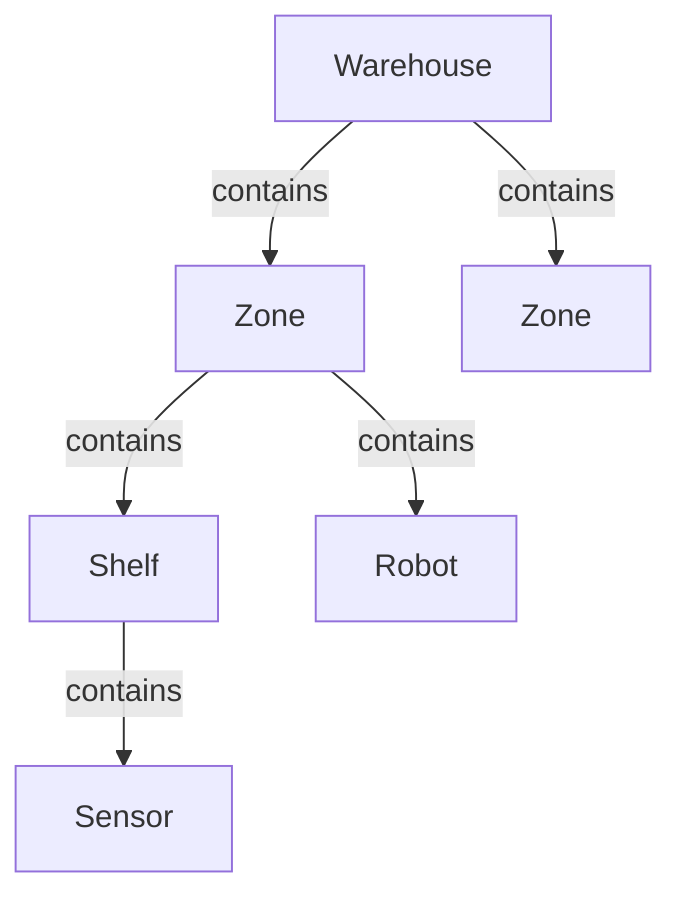

# Architecture and modeling

Azure Digital Twins represents a physical environment as a graph. A model defines what a kind of entity can contain; a twin is a running instance of that model; relationships describe how twins connect.


## Core building blocks

| Building block | Purpose in the warehouse sample |
| --- | --- |
| DTDL model | Defines the schema for a warehouse, zone, shelf, sensor, or robot. |
| Digital twin | Holds the current state of one physical or logical entity. |
| Relationship | Connects twins, such as a warehouse containing a zone. |
| Telemetry | Streams observations such as shelf load, temperature, or robot battery level. |
| Event route | Sends change notifications to downstream services. |

## Warehouse model graph

The repository includes five DTDL models under [models/](https://github.com/Cloud2BR-MSFTLearningHub/Azure-DigitalTwins-Overview/tree/main/models). Upload dependent models before models that reference them.



| Model | Example state | Primary signals |
| --- | --- | --- |
| Warehouse | Name and location | Relationships to zones |
| Zone | Operational area | Relationships to shelves, sensors, and robots |
| Shelf | Capacity and identity | `currentLoad` telemetry |
| Sensor | Type and identity | Temperature and humidity telemetry |
| Robot | Robot identity | Battery telemetry and movement command |

## DTDL design guidance

1. Model stable domain concepts, not individual telemetry messages.
2. Use properties for durable state and telemetry for observations that change frequently.
3. Use relationships to express graph navigation, such as zone-to-shelf or shelf-to-sensor.
4. Use versioned model identifiers and assess model changes for compatibility.
5. Give twins predictable identifiers so operational queries and automation are repeatable.

!!! tip
    Validate models before uploading them. The Azure Digital Twins Explorer and the Digital Twins Definition Language extension for Visual Studio Code are useful during authoring.

## Model registration order

The sample scripts upload `warehouse.json`, `zone.json`, `shelf.json`, `sensor.json`, and `robot.json`. Review dependencies in the JSON files and register referenced models before their dependents when you extend the graph.

```bash
az login
az extension add --name azure-iot
az dt model create --dt-name <instance-name> --models models/warehouse.json
```

For a complete warehouse setup, continue to [Warehouse deployment](warehouse-deployment.md).