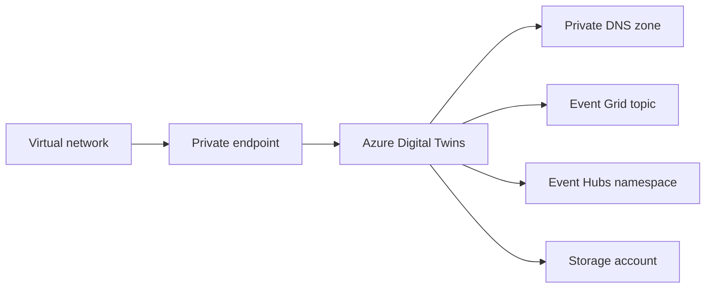

# Automation and operations

The repository provides two repeatable deployment paths. Use Terraform for the Azure infrastructure foundation, then use PowerShell or CLI automation to register models and create the sample graph.

## Choose a deployment path

| Path | Best for | Repository entry point |
| --- | --- | --- |
| Azure portal and CLI | Learning the service and inspecting each resource | [Warehouse deployment](warehouse-deployment.md) |
| PowerShell scripts | Creating the sample models, twins, and relationships | `adt-deploy-full.ps1` or `adt-deploy-models.ps1` |
| Terraform | Creating the resource group, network, private endpoint, storage, and messaging foundation | `terraform-infrastructure/` |

## PowerShell and Makefile automation

The `Makefile` exposes the common commands. On Windows, run these from a shell that can invoke `make` and PowerShell.

```bash
make help
make deploy-simple
make deploy
make diagnostics
```

`adt-deploy-full.ps1` creates the warehouse graph, including zones, shelves, sensors, robots, and relationships. It uses default names such as `WarehouseDigitalTwins` and `WarehouseDT-rg`; review and adapt those values before running it in a shared subscription.

!!! warning
    The scripts create Azure resources and assign the Azure Digital Twins Data Owner role to the signed-in user. Review names, region, permissions, and expected charges before execution.

## Terraform infrastructure

The Terraform configuration provisions a resource group, virtual network, private DNS zone, private endpoint, storage account, Event Hubs namespace, Event Grid topic, and supporting network security group. It invokes Azure CLI for resources that are not expressed through a native Terraform resource in this implementation.

```bash
cd terraform-infrastructure
terraform init
terraform plan
terraform apply
```



## Operational checks

- Verify the current Azure account and subscription before deploying.
- Confirm model registration and inspect the model IDs returned by Azure Digital Twins.
- Query the graph after creating twins and relationships.
- Monitor event routing and telemetry processing failures.
- Run `make diagnostics` when access, model, or graph creation needs investigation.
- Remove the created resource group when the workshop is no longer needed.

## Production considerations

For production workloads, use managed identities, least-privilege Azure roles, private networking, central logging, alerting, tagging, cost budgets, and a tested lifecycle process for model changes. Treat the warehouse graph and its DTDL contracts as versioned application artifacts.