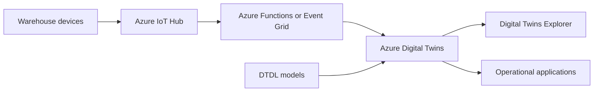

# Azure Digital Twins Overview Hub

Last updated: 2026-07-29

List of references

- [What is Azure Digital Twins?](https://learn.microsoft.com/azure/digital-twins/overview)
- [Azure Digital Twins models](https://learn.microsoft.com/azure/digital-twins/concepts-models)
- [Azure Digital Twins pricing](https://azure.microsoft.com/pricing/details/digital-twins/)

Azure Digital Twins is a platform for modeling physical environments as a live graph of entities, properties, telemetry, and relationships. This hub uses the repository's warehouse example to show how Digital Twins Definition Language (DTDL), Azure services, and automation fit together.

!!! warning
    These guides are learning material. Confirm current Azure service behavior, support, pricing, and compliance requirements in Microsoft's official documentation before production use.

  <a class="guide-card" href="architecture-and-modeling/"><strong>Architecture and modeling</strong> Understand the live graph, DTDL building blocks, and the warehouse model hierarchy.</a>
  <a class="guide-card" href="warehouse-deployment/"><strong>Warehouse deployment</strong> Create an instance, register models, build twins, relationships, and telemetry routing.</a>
  <a class="guide-card" href="automation-and-operations/"><strong>Automation and operations</strong> Choose Terraform or PowerShell automation, validate deployment, and operate the graph.</a>

## Start here

| Need | Start with |
| --- | --- |
| Understand Azure Digital Twins and DTDL | [Architecture and modeling](architecture-and-modeling.md) |
| Build the warehouse sample from the Azure portal | [Warehouse deployment](warehouse-deployment.md) |
| Automate deployment, diagnostics, and private networking | [Automation and operations](automation-and-operations.md) |